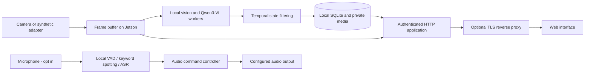
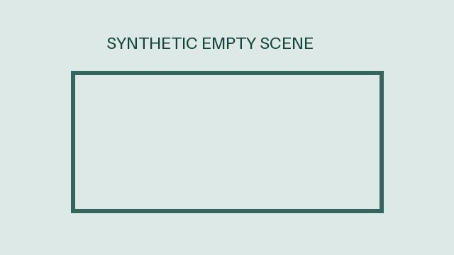

# Edge AI Infant Monitoring Research Platform

A privacy-aware research platform for camera perception, local vision-language inference,
offline audio interaction, and authenticated real-time monitoring on NVIDIA Jetson.

**Research software, not a medical device or a substitute for adult supervision.**
Model outputs are uncertain observations and must not be used as clinical diagnoses or
as the sole basis for safety decisions. No private recordings or model weights are distributed.

## Features

- Real-time camera snapshots and MJPEG, plus server-sent state events.
- Optional local Qwen3-VL observations and lightweight face/expression inference.
- Temporal state filtering, activity/posture timelines and explicitly saved images.
- Offline keyword spotting, voice activity detection and speech commands.
- Configurable AirPlay or PipeWire audio playback; no copyrighted music is included.
- Username/password authentication, revocable sessions and CSRF protection for all clients.
- Owner-controlled monitoring access and photo-ID-based image delivery.
- Hardware-free demo using geometric images with no people or embedded metadata.

## Architecture



Vision and audio are parallel local pipelines. Speech commands control playback;
this release does not claim a jointly trained audio-visual model or clinical validation.
The optional model worker is restricted to loopback and is never exposed through the photo API.

## Installation

For development across a Mac and Jetson over SSH, see
[the Git workflow](docs/GIT_WORKFLOW.md).

Use Python 3.11 or later. Run these commands from this checkout:

```bash
python3 -m venv .venv
source .venv/bin/activate
python -m pip install -r requirements.txt
python -B scripts/configure-auth.py
bash scripts/run.sh
```

Choose your own username and a password of at least 14 characters. The configuration helper
creates an ignored `.env` with a salted password hash, restrictive permissions, and the
synthetic demo enabled. It refuses to overwrite an existing file. No default login is provided.

Open **http://localhost:8080** and sign in. The hostname must match `BMON_PUBLIC_ORIGIN`;
using another alias will be rejected. `.env.example` documents the supported settings.
The application itself does not auto-load environment files; `scripts/run.sh` exports them.

The demo displays a labeled geometric empty scene. It does not perform inference or use
camera/microphone hardware. To stop, press Ctrl+C. Runtime data goes into the ignored `data/`
directory. Changing environment settings requires a restart; restarting revokes all sessions.

## Jetson deployment

For the provisioned local vision models, paths, offline verification and worker startup,
see [Jetson model setup](docs/JETSON_MODELS.md).

Set `BMON_DEMO=false` in the private environment file to enable the camera adapter.
The camera path uses GStreamer via Python GI. On a compatible JetPack installation, provide
`python3-gi`, GStreamer tools/plugins and the GI Gst bindings using the operating system's
package manager. A venv created with `--system-site-packages` can access these system bindings.
Set `BMON_CAMERA_DEVICE` for your camera. Camera/JetPack integration has not been tested on
physical hardware for this public release.

For lightweight vision, review `MODEL_LICENSE.md`, install `requirements-lightweight.txt`
in a compatible environment, and supply your own downloaded YuNet/expression models.
Enable `BMON_MODEL_ENABLED=true` only after verifying their installation and terms.

For Qwen3-VL, use a separate Jetson-compatible PyTorch/Transformers environment and a locally
downloaded `Qwen3-VL-2B-Instruct` directory. Set `BMON_VLM_MODEL_PATH` in that worker's environment
and run `python -B model_server.py`. In the application's private configuration set
`BMON_VLM_ENABLED=true` and `BMON_VLM_SERVICE_URL=http://127.0.0.1:8010`.
The worker needs PyTorch, Transformers, Accelerate and Pillow compatible with the installed
JetPack/CUDA stack. Those GPU versions are intentionally not claimed to be universally portable.

For optional audio, see `docs/AUDIO.md`. All media and weights are provisioned separately.
An example **user** service is in `deploy/baby-monitor.service`; adapt its generic checkout
location before installing. No device disks, UUIDs, accounts or system services are modified
by this repository's setup instructions.

## Remote access and security

All clients, including loopback, require login. For network use, keep the application bound
to loopback behind a TLS reverse proxy and set `BMON_PUBLIC_ORIGIN` to the exact external HTTPS
origin. Preserve the external `Host` header, disable proxy buffering for SSE/MJPEG and prevent
direct network access to the upstream HTTP port. The application does not terminate TLS.
Do not expose the model worker. See `SECURITY.md` for the trust model and limitations.

Turning off **monitoring access** terminates existing MJPEG/SSE connections and blocks subsequent
monitoring requests. The authenticated owner can still open settings and restore access.
**This switch does not stop camera collection, inference or local recording.** Stop the service
when collection must stop. Bytes already downloaded cannot be recalled.

All authenticated sessions belong to one configured owner and share that owner's photo library.
There is no multi-user or tenant isolation. Photos are served only by existing photo IDs,
with allowlisted storage subdirectories and image formats. Arbitrary `/media/` paths are rejected.

## Demo



`examples/sample_result.json` is an explicitly synthetic response fixture, not an accuracy claim
or an actual inference result. Every shipped image is an original geometric illustration;
there are no photographs, faces, GPS records or copied audio recordings.

## API

- `GET /api/status`, `/api/timeline`, `/api/observations`: authenticated research state.
- `GET /snapshot.jpg`, `/stream.mjpg`, `/api/events`: authenticated live outputs.
- `GET /api/photos`, `/api/smiles`: photo records with opaque delivery URLs.
- `GET /api/photos/{id}/original` or `/thumbnail`: authorized JPEG response, never a filesystem path.
- `POST /api/access`: owner access control; `key` must be `lan_enabled`.
- Other state-changing APIs require the same session, exact `Origin`, and `X-CSRF-Token`.
- `POST /logout`: revoke the session and close its live streams.

## Verification

```bash
python -B -m unittest discover -s tests -v
python -B scripts/scan-release.py
```

Tests use synthetic data and explicitly marked test-only credentials. Optional pinyin tests
are skipped if `pypinyin` is unavailable. Hardware, GPU inference and production TLS must be
validated on the target system. The release scanner is a heuristic guard, not proof that any
arbitrary future contribution is safe.

## License and attribution

Original project code and generated geometric artwork are provided under Apache-2.0; see
`LICENSE`. Third-party software and models retain their own terms. See `THIRD_PARTY.md` and
`MODEL_LICENSE.md`. No pretrained weights or third-party source packages are bundled.

### Local preview without sign-in

For a temporary private test, set `BMON_LOCAL_PREVIEW_NO_LOGIN=true` in the deployment environment. This defaults to false. Preview session creation is restricted to a loopback listener, loopback client, and loopback public origin; use a private SSH tunnel for remote hardware. Anyone with access to that local forwarded port can enter without a password. Session cookies, Host checks, and CSRF checks remain active. Remove the setting and restart to restore sign-in.

For an explicitly trusted private LAN test only, set `BMON_PREVIEW_LAN_SUBNET` to a private IPv4 subnet with prefix /24 or narrower, set `BMON_HOST` to the device LAN address, and set `BMON_PUBLIC_ORIGIN` to the matching HTTP origin and port. With `BMON_LOCAL_PREVIEW_NO_LOGIN=true`, devices in that subnet can view without signing in. This temporary mode uses unencrypted HTTP; do not port-forward it. Clients outside the configured subnet are rejected. Unset both preview variables and restart to restore normal authentication and HTTPS requirements.
